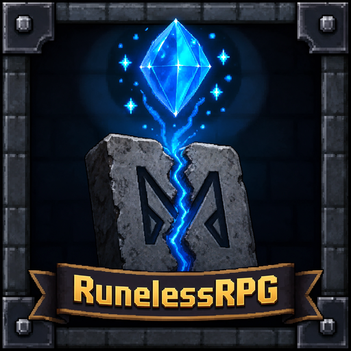
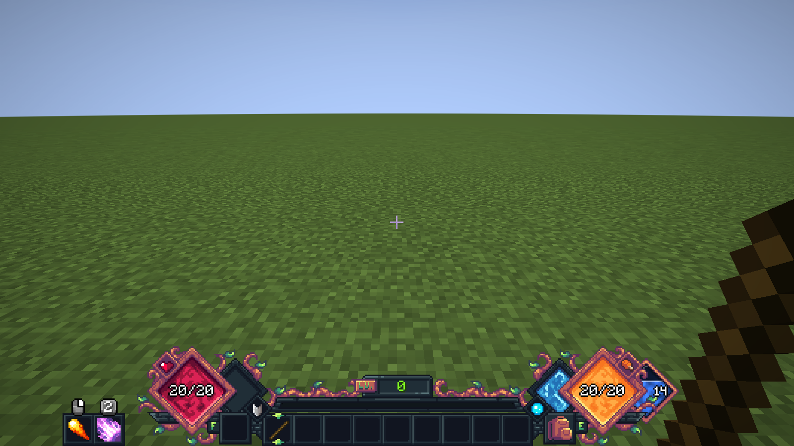
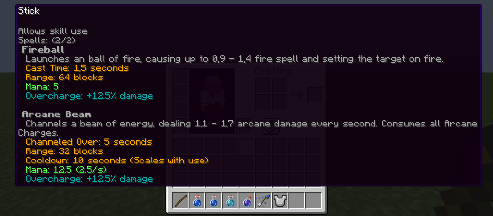
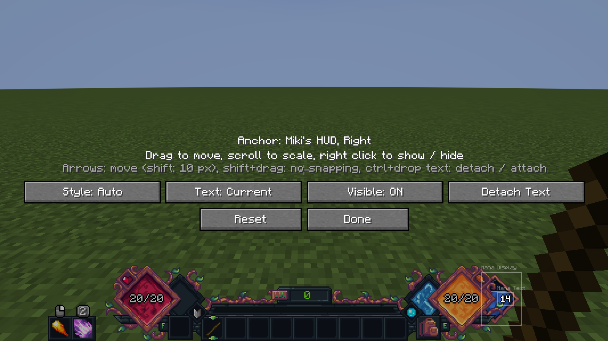
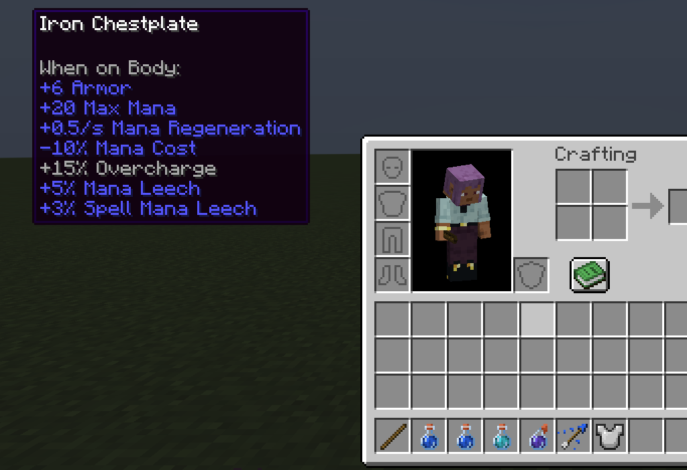
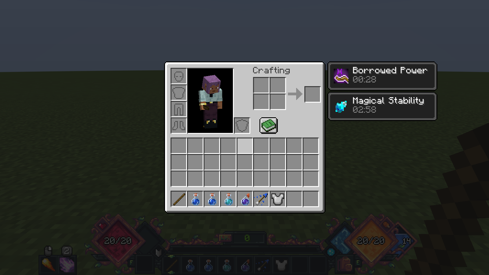

<p align="center">
  
</p>

<h1 align="center">RunelessRPG</h1>

<p align="center">
  
  
  
</p>

🔮 **Spell Engine without runes.** RunelessRPG is a NeoForge mod for Minecraft 1.21.1 (Java 21) that gives every
player a mana pool and makes Spell Engine spells, class skills and weapon skills cost mana instead of runes. Mana comes
back over time, gear, enchantments, potions and affixes make the pool bigger, and a mana display sits next to the
hotbar, docked at Miki's Fantasy HUD when it is installed.

> **Client & Server required.** Mana, costs and the mana display need the mod on the server and on every client, in
> the same version.
>
> **Spell Engine required, everything else optional.** Miki's Fantasy HUD, Apotheosis and the RPG Series class mods
> are picked up when they are installed.
>
> **Built for pack developers.** Base values, the cost per spell tier, categories, multipliers and the mana mode are
> config options; categories are spell tags; single spells can get their own cost from a datapack. The full
> documentation is in the [wiki](https://github.com/Drehverschluss/RunelessRPG/wiki).

## Screenshots



| | |
|---|---|
|  |  |
|  |  |

## How it works

RunelessRPG hooks into Spell Engine's cost check (`Ammo.ammoForSpell`) on client and server: for every spell it
handles, the rune cost is replaced by a mana cost, and the cast is blocked when the mana is too low. The mana is taken
when Spell Engine finishes the cast, or tick by tick for channeled spells. Other cost items (arrows) stay as they are.

Which spells cost mana is decided by spell tags (`#runelessrpg:cost/*`) and by Spell Engine's rune cost; the amount
comes from a table of costs per spell tier times a multiplier per category, or from a datapack value. The current mana
is stored with the player and sent to the client, so the client can check casts and show costs in the tooltip before
anything is sent to the server.

## Installation

1. Install NeoForge `21.1` for Minecraft `1.21.1`.
2. Install Spell Engine (it brings Spell Power, Cloth Config and playerAnimator).
3. Put `runelessrpg-0.1.0.jar` into the `mods` folder of the **server and of every client**.
4. Optional: install any of the mods below; RunelessRPG picks them up automatically.

| Mod | Tested version | Needed |
|---|---|---|
| Spell Engine | `1.10.9+1.21.1` | **required** (`1.10.0` or newer) |
| Spell Power | `1.6.0+1.21.1` | required by Spell Engine |
| Miki's Fantasy HUD | `1.0.8` | optional (mana display docks at its diamonds) |
| Apotheosis | `1.21.1-8.9.0` | optional (six affixes, own affix type) |
| Apothic Attributes | `1.21.1-2.11.0` | optional (comes with Apotheosis) |
| Placebo | `1.21.1-9.9.4` | optional (comes with Apotheosis) |
| Gearscope | `0.3.0` | optional (shows the attribute icons) |
| Runes | `1.3.2+1.21.1` | optional (rune costs are recognized by its tag) |
| Wizards, Paladins & Priests, Rogues & Warriors, Archers | `3.1.3` | optional (their spells and skills cost mana) |

## What it does

### Mana and costs

Every player has `runelessrpg:max_mana` (20) and `runelessrpg:mana_regen` (0.5 per second). Spells cost the value of
their tier in a cost table (4, 5, 7, 10, 14, 18), times 1.0 for spells, 0.75 for class skills and 0.5 for weapon
skills, times the player's Mana Cost (never below 50 %). Spells that cannot be paid are not cast; Spell Engine shows
"missing Mana" and the bar flashes. Debt modes and the Potion of Borrowed Power allow casting below 0. Runes are never
consumed, arrows are. More: [Wiki → Spell costs](https://github.com/Drehverschluss/RunelessRPG/wiki/Spell-Costs),
[Wiki → Mana and attributes](https://github.com/Drehverschluss/RunelessRPG/wiki/Mana-and-Attributes).

### Channeled spells

Channeled spells (Arcane Beam, Blizzard, Whirlwind …) pay tick by tick: stopping early is cheaper, running out of mana
ends the channel. Interrupting a channel by switching items still sets its cooldown. Two other modes pay everything at
the start or at the end. More: [Wiki → Spell costs](https://github.com/Drehverschluss/RunelessRPG/wiki/Spell-Costs#channeled-spells).

### Overcharge and leech

Overcharge makes spells cost more and deal more damage and healing (+20 % cost = +10 % damage by default); summons and
spell clouds keep the bonus they were paid with. Mana Leech turns weapon damage into mana, Spell Mana Leech the damage
of direct spell hits; further targets in the same tick give less, overkill and summons give nothing. More:
[Wiki → Overcharge and leech](https://github.com/Drehverschluss/RunelessRPG/wiki/Overcharge-and-Leech).

### Mana HUD

Six styles (thin bar, framed bar, vertical bar, half diamond and band at Miki's diamonds), nine screen anchors plus four
anchors at Miki's HUD that follow its scaling, a layout editor (drag, scroll, right click), its own mana number with
automatic fitting, a red flash when mana is missing and a hover tooltip. More:
[Wiki → Mana HUD](https://github.com/Drehverschluss/RunelessRPG/wiki/Mana-HUD).

### Enchantments and potions

Seven enchantments for armor and spell weapons (Max Mana, regeneration, Mana Cost, Overcharge), Potions of Mana I/II,
Magical Stability (−15 % Mana Cost) and Borrowed Power (cast into debt, backlash damage when it ends in debt), with
configurable brewing ingredients. Spell Engine's Spell Infinity lowers mana costs. More:
[Wiki → Enchantments](https://github.com/Drehverschluss/RunelessRPG/wiki/Enchantments),
[Wiki → Potions](https://github.com/Drehverschluss/RunelessRPG/wiki/Potions).

### Apotheosis

With Apotheosis, six affixes for the six attributes; the spell weapon affixes only roll on spell weapons thanks to an
own affix type `runelessrpg:attribute` with item filters. If a future Apotheosis version breaks the integration, it is
switched off with one warning and the rest keeps working. More:
[Wiki → Apotheosis affixes](https://github.com/Drehverschluss/RunelessRPG/wiki/Apotheosis-Affixes).

## Configuration

| File | Section | Most important options |
|---|---|---|
| `runelessrpg-server.toml` | `mana` | `baseMaxMana` (20), `baseManaRegen` (0.5) |
| | `casting` | `manaMode` (`FULL_COST` / `DEBT` / `DEBT_LIMIT`), `minManaCostPercent` (50), `creativeFreeCasting` |
| | `costs` | `tierCosts`, `*Enabled` and `*Multiplier` per category |
| | `channel` | `channelCostMode` (`DRAIN` / `START` / `END`), `cooldownOnChannelAbort` |
| | `overcharge`, `mana_leech`, `spell_infinity`, `potions` | Factors and values of these features |
| `runelessrpg-common.toml` | `brewing` | Brewing ingredients |
| `runelessrpg-client.toml` | `hud`, `text`, `flash` | Style, anchor, offsets, scale, colors, mana number, flash |

The server config is sent to the clients and applies while the game runs. All options:
[Wiki → Configuration](https://github.com/Drehverschluss/RunelessRPG/wiki/Configuration).

## Data-driven customization

| Path | Content |
|---|---|
| `data/<ns>/tags/spell/` → `runelessrpg:cost/spells`, `class_skills`, `weapon_skills`, `item_abilities`, `free` | Which spell belongs to which cost category |
| `data/<ns>/runelessrpg/spell_costs/*.json` | Fixed base cost per spell (`{"costs": {"wizards:fireball": 6}}`) |
| `data/runelessrpg/tags/item/enchantable/armor.json`, `magic_weapon.json` | Items for the enchantments and the spell weapon affixes |
| `data/runelessrpg/tags/damage_type/mana_leech/weapon_damage.json` | Damage types that count for Mana Leech |
| `data/runelessrpg/tags/entity_type/no_mana_leech.json` | Entities that never give mana |
| `data/runelessrpg/enchantment/*.json`, `data/runelessrpg/affixes/**` | Enchantments and Apotheosis affixes |
| `config/runelessrpg/spell_costs_report.json` | Generated overview of all spells with category and base cost |

More: [Wiki → Datapacks and tags](https://github.com/Drehverschluss/RunelessRPG/wiki/Datapacks-and-Tags). Commands:
`/runelessrpg mana`, `/runelessrpg cost`, `/runelessrpg report`
([Wiki → Commands](https://github.com/Drehverschluss/RunelessRPG/wiki/Commands)); API and events for other mods and
KubeJS: [Wiki → API and events](https://github.com/Drehverschluss/RunelessRPG/wiki/API-and-Events).

## Mod compatibility

- **Spell Engine**: every spell that costs runes costs mana; class and weapon skills through the bundled tags. Spells
  cast by summons and mobs never cost anything.
- **Miki's Fantasy HUD**: four docking anchors, two styles made for its diamonds, drawn behind its artwork with the
  number in front.
- **Apotheosis**: six affixes and the affix type `runelessrpg:attribute`, guarded by the load condition
  `runelessrpg:apotheosis_integration`.
- **RPG Series equipment configs, Dungeon Difficulty, KubeJS**: the attributes are normal attributes; examples in
  [Wiki → Pack integration](https://github.com/Drehverschluss/RunelessRPG/wiki/Pack-Integration).
- **Gearscope** shows the attribute icons.

## Project layout

| Package | Content |
|---|---|
| `com.drehverschluss.runelessrpg` | `RunelessRPG` (common entry point) and `RunelessRPGClient` (client entry point) |
| `api` | `RunelessApi`, `ManaCostEvent`, `ManaChangeEvent`, `ManaCategory` |
| `attribute` | The six attributes |
| `mana` | Mana attachment, `ManaManager`, login / respawn / regeneration |
| `cost` | Categories, cost calculation, cast check, channeled spells, datapack costs, cost report |
| `impact` | Overcharge, Mana Leech and Spell Mana Leech, origin of spell hits |
| `potion` | Effects, potions, brewing, Borrowed Power |
| `item` | The placeholder item `runelessrpg:mana` (shown as the missing item) |
| `config` | Server and common config |
| `command` | `/runelessrpg` |
| `network` | Payloads and their registration |
| `client`, `client.hud`, `client.screen`, `client.config` | Tooltips, mana display, mana number, layout editor, client config |
| `compat.*` | Apotheosis integration; only loaded when Apotheosis is installed |
| `mixin` | Spell Engine and vanilla hooks (no `@Overwrite`, no `@Redirect`) |
| `util` | Cost formatting |

## Development

Requires Java 21.

- Spell Engine and Spell Power are compiled against from the Modrinth Maven (`maven.modrinth:*`), Apotheosis, Apothic
  Attributes and Placebo from the Shadows of Fire Maven. No local jars are needed to build.
- For the dev runs, every jar in `libs/test/` (git-ignored) is added via `localRuntime`, so `runClient` and `runServer`
  behave like the target modpack. Put Spell Engine and the mods you want to test with there; jars in subfolders are not
  loaded.

```
./gradlew build        # jar in build/libs
./gradlew runClient    # dev client (game directory run/)
./gradlew runServer    # dev dedicated server (game directory run/, accept the EULA on first start)
```

### Testing

1. `runClient` with Spell Engine and Wizards in `libs/test/`: a wand's tooltip shows "Mana: 4" for Fireball, no rune
   line. Cast it; the mana goes down by 4 and comes back at 0.5 per second.
2. `/runelessrpg mana @s set 2` and cast Fireball: it is not cast, "Mana" is shown as missing and the bar flashes.
3. Channel Arcane Beam and release it early: only the channeled part is paid. Switch items while channeling: the
   cooldown is still set.
4. `/runelessrpg cost wizards:fireball` and `/runelessrpg report` (file in `config/runelessrpg/`).
5. Put on gear with `runelessrpg:max_mana`, set mana above the base, relog and die: the mana is kept on relog and full
   after respawn.
6. Bind *Edit HUD Layout*, move and scale the bar and the number, restart: the layout is kept.
7. Brew a Potion of Mana (Awkward Potion + Lapis Lazuli) and drink it.
8. With Apotheosis, Apothic Attributes and Placebo in `libs/test/`: affixed armor and staffs can roll the RunelessRPG
   affixes; staffs never get Mana Leech, swords never get the spell weapon affixes.
9. `runServer` and connect with `runClient` (multiplayer, `localhost`).

## License and credits

MIT, see [LICENSE](LICENSE). Credits and licenses of everything RunelessRPG uses or refers to are in
[CREDITS.md](CREDITS.md).

- The mana item texture and the effect icons are from [RPGMana](https://github.com/cleannrooster/rpgmana) by
  cleannrooster (MIT License, see [CREDITS.md](CREDITS.md)), which was also the idea source for several enchantments and potions (own implementation,
  no code used).
- The attribute icons are from the "RPG Icon Pack – 400+ Skills and Spells" by Clockwork Raven Studios.
- The idea of the generated cost report is inspired by Savaru's Mana.
- RunelessRPG is an unofficial add-on and not affiliated with Spell Engine, Miki's Fantasy HUD, Apotheosis or any of
  the other mods.
- Bug reports and suggestions: [issue tracker](https://github.com/Drehverschluss/RunelessRPG/issues).
